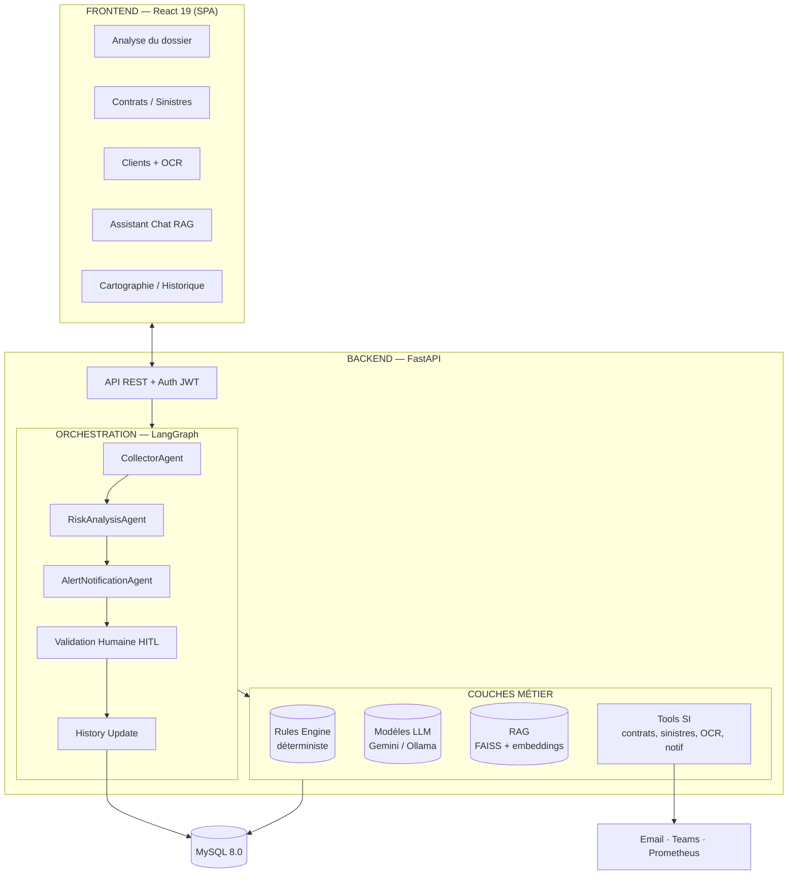
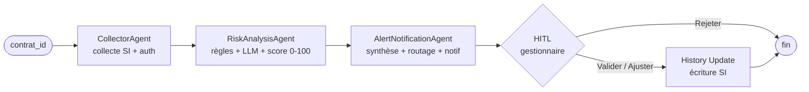

# ARCHITECTURE — « Le Contrat Vivant »

**Document à destination de l'encadrant** — présentation de l'architecture et clarification du rôle des modèles d'IA.

---

## 1. Vue d'ensemble (schéma global)

> **Lecture** : le frontend appelle l'API FastAPI, qui déclenche le workflow LangGraph.
> Les agents s'appuient sur des **couches métier** dont une seule — `LLM` — est un modèle génératif.

---

## 2. Le workflow multi-agents (LangGraph)

---

## 3. Réponse à la question : « le modèle fait-il tout ? »

**Non.** Le LLM est **un composant parmi plusieurs**, utilisé uniquement là où il apporte de la valeur.
Tout le reste est du code **déterministe** (règles, requêtes SQL, contrôles), traçable et vérifiable.

### 3.1 Ce que fait le MODÈLE (LLM / IA générative)

| Cas d'usage | Module | Nature |
|---|---|---|
| Extraction documents image | `cin_ocr_tool`, `constat_ocr_tool`, `devis_analyzer_tool` | Vision → JSON |
| Analyse complémentaire (anomalies) | `cross_analysis_node` | Texte |
| Synthèse du dossier | `summarizer_node` | Texte |
| Assistant contextuel (chat) | `chat_node` + RAG | Texte |
| Embeddings / recherche RAG | `rag/` | Vecteurs |

### 3.2 Ce que fait le CODE (sans modèle)

| Responsabilité | Module | Pourquoi c'est déterministe |
|---|---|---|
| Collecte contrat + sinistres | `collect_node`, `si_*.py` | Lecture MySQL, pas de génération |
| Calcul du risque (score 0-100) | `rules_engine/risk_analyzer.py` | Pondérations et seuils fixes |
| Règles métier | `rules_engine/rules/*` | Logique `if` explicite |
| Authentification / rôles | `auth_*`, `permissions_tool` | JWT + contrôles d'accès |
| Notifications | `notification_tool`, `cross_notification_tool` | Envoi Email/Teams |
| Validation humaine (HITL) | `human_validation_node` | Décision gestionnaire |
| Traçabilité / rollback | `audit_log_tool`, `revert_tool` | Logs + historique SI |
| Fallback OCR | Tesseract + regex | Si le modèle est indisponible |

### 3.3 Preuve de robustesse (argument clé)

Si le modèle échoue (quota, JSON invalide, hors-ligne) :
- l'OCR retombe sur **Tesseract + regex** (`cin_ocr_tool.py`),
- l'analyse retombe sur le **moteur de règles déterministe**,
- le pipeline continue et reste **traçable** (`audit_log_tool`).

> Le modèle **assiste** la décision, il ne la **remplace** pas. La décision finale
> (validation/ajustement/rejet) est toujours humaine (HITL) avant toute écriture en base.

---

## 4. Pour résumer à l'oral

1. **Un workflow multi-agents** (LangGraph) orchestre le traitement d'un dossier.
2. **Deux types d'intelligence** : règles métier explicites + LLM complémentaire.
3. **Le LLM n'est pas le système** : extraction, analyse, synthèse et chat seulement.
4. **Sécurité** : validation humaine obligatoire + audit log + rollback.
5. **Résilience** : fallbacks déterministes si l'IA est indisponible.
